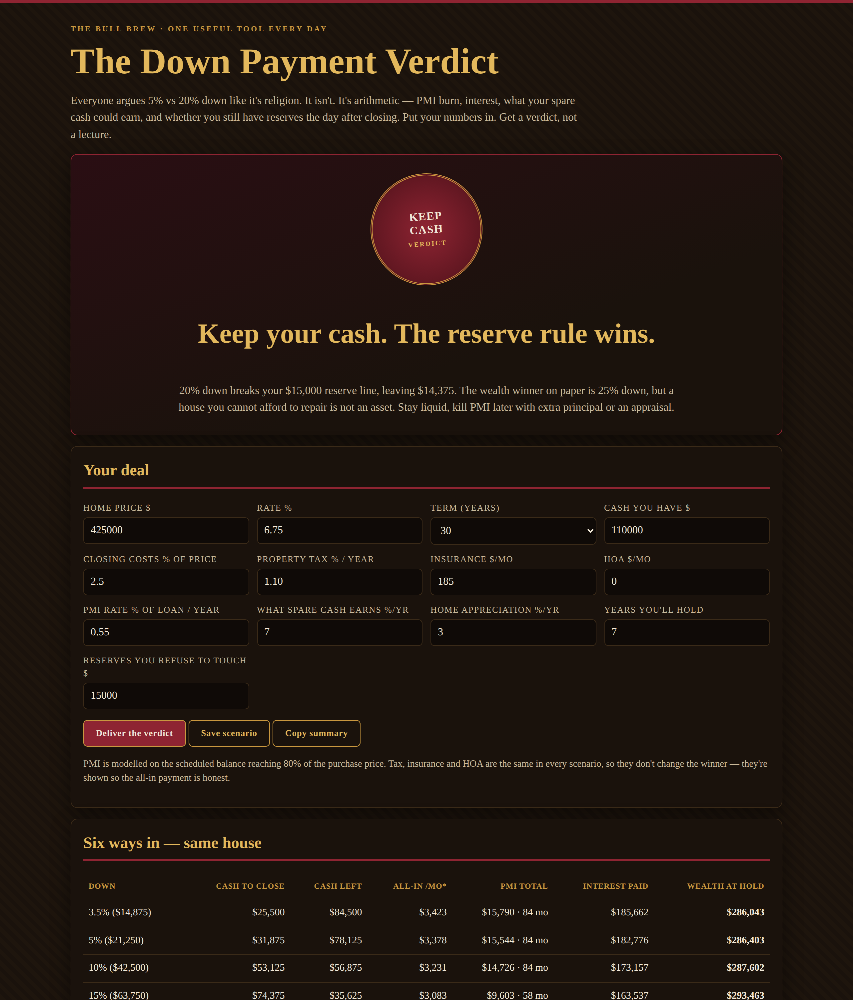

# The Down Payment Verdict

**Live:** https://thebullbrew.github.io/down-payment-verdict/

Everyone argues 5% vs 20% down like it's religion. It isn't — it's arithmetic. This tool runs six down payments (3.5%, 5%, 10%, 15%, 20%, 25%) on the same house and judges them on the only fair basis: real wealth at the end of your actual hold.

## What it does

- **Six-way showdown** — cash to close, cash left, month-one all-in payment, total PMI to the month it dies (scheduled 80% LTV), interest paid over the hold, and wealth at hold for every down payment, with the winner lit.
- **Honest wealth math** — wealth = home equity + leftover cash grown at your investment return + every month of payment savings versus the dearest option, also invested. No scenario gets to hide its cash.
- **Reserve guard** — if 20% down breaks the reserve line you refuse to touch, the verdict says KEEP CASH before any spreadsheet speaks.
- **Seal verdicts** — KEEP CASH / GO 20%+ / GO SMALL / SPLIT IT, judged on reserves first, then wealth, then PMI burn.
- **20% vs 5% showdown** — extra cash down, monthly saving, PMI avoided, interest saved, opportunity cost of the extra down, net winner, and payback in months.
- **Hold sensitivity** — net advantage of 20% over 5% at 3, 5, 7, 10 and 15 years. Short holds punish big down payments.
- **Saveable scenarios** (localStorage), copyable summary, works fully offline as a PWA.

## The method behind it

Three rules. First, reserves beat percentages — a 20% down payment that leaves you $900 and a 40-year-old furnace is theatre, not strategy. Second, PMI is rent you pay for your own money: price it in full, to the month it dies. Third, cash has a job — every extra dollar down is a dollar that can't be invested, fix a roof, or carry you through a bad quarter. If it doesn't beat what that dollar earns outside the house, it stays outside the house.

Design: dark old-money variation 16 (Port & Cigar) — port-wine red for primary actions and hero panels, amber-gold type, leather-textured card tops.

## How to run

Open `docs/index.html` in any browser, or serve the `docs/` folder with any static host. No build step, no backend, no accounts. Everything runs on your device.

*Estimates only — not financial advice. Built by [The Bull Brew](https://thebullbrew.com) · One useful tool, every day.*
